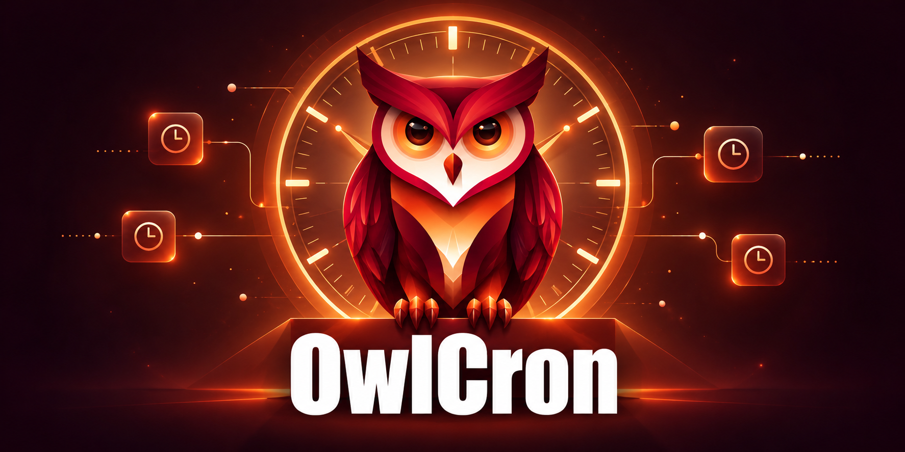

# OwlCron

English | [简体中文](README.zh-CN.md)

OwlCron is a task scheduler written in Go, designed to replace [Cronicle](https://github.com/jhuckaby/Cronicle). It provides a web interface, scheduled and on-demand jobs, plugin execution, job logs, and notifications, with selected compatibility for Cronicle workflows, APIs, and plugin conventions. See [Cronicle compatibility](docs/compatibility.md) for the current migration scope.

The project is experimental. Review the [known limitations](docs/limitations.md), including sustained cluster convergence, remote dispatch acknowledgment, and production capacity, before deploying it.


## Go quality reports

Go quality reports run on tags, published releases, and manual dispatches. They run tests with the race detector and coverage, check the independent example plugin, and generate Go Report Card results. Download reports and raw test evidence from the workflow artifacts (retained for 14 days). Stable reports are committed only when the tested commit still matches the default branch; otherwise they remain artifacts. The existing CI continues to check pull requests.

[Go quality reports](https://github.com/soulteary/owlcron/actions/workflows/go-quality-reports.yml)



## Quick start

Install Go, Bun 1.4.2, Python 3, and make. The module recommends Go 1.27.3; see the [deployment requirements](docs/deployment.md) before choosing another toolchain.

```sh
git clone https://github.com/soulteary/owlcron.git
cd owlcron
bun install --cwd htdocs-deps --frozen-lockfile
make frontend build
cp config.json config.local.json
chmod 600 config.local.json
```

Edit `config.local.json` and replace `secret_key` with a random secret of at least 32 bytes. Then initialize storage and start the service:

```sh
./owlcron-engine -config config.local.json setup
./owlcron-engine -config config.local.json
```

On the first start with an empty user database, OwlCron generates administrator credentials in `data/bootstrap-admin.json`. Read this file in a trusted terminal, then sign in at `http://localhost:3012`. You can also supply credentials before the first start; see [installation and startup](docs/deployment.md#installation-and-startup).

Initialization provides a General category and an Echo Plugin. Create a local event using that plugin, run it manually, and inspect its history and logs. `make smoke` checks this workflow automatically with isolated temporary data.

The HTTP service listens on all interfaces. `base_app_url` does not restrict the listening address. Restrict access to the backend port and configure HTTPS before exposing the service. Keep secrets, runtime data, and logs out of version control.

## Documentation

- [Deployment](docs/deployment.md): installation, HTTPS, permissions, backups, and upgrades.
- [Configuration](docs/configuration.md): storage, retention, notifications, and node identity.
- [Cronicle compatibility](docs/compatibility.md): supported behavior and migration differences.
- [Architecture](docs/architecture.md): scheduling, persistence, completion acknowledgment, and recovery.
- [Testing](docs/testing.md): local checks, CI, and fault acceptance tests.
- [Known limitations](docs/limitations.md): constraints to consider before deployment.
- [Contributing](CONTRIBUTING.md) and [security policy](SECURITY.md).

The [documentation index](docs/README.md) links to both language editions.

## Development checks

Run these commands from the repository root:

```sh
bun install --cwd htdocs-deps --frozen-lockfile
make frontend build
make fmt-check vet test frontend-test licenses-check docs-check smoke
```

Run `make race` for race detection. See [testing](docs/testing.md) for Docker-based fault scenarios. The example plugin is a separate Go module; changes to it also require checks in `bin/echo-plugin`.

The optional [real-browser smoke test](tests/browser/README.md) covers login, event editing and execution, history, logs, and theme persistence in Chromium.

## License

OwlCron's original code uses the [MIT License](LICENSE). Inherited Cronicle code retains its original copyright and MIT terms. Third-party code and fonts retain their respective licenses; see [third-party notices](THIRD_PARTY_NOTICES.md) and `licenses/`.
